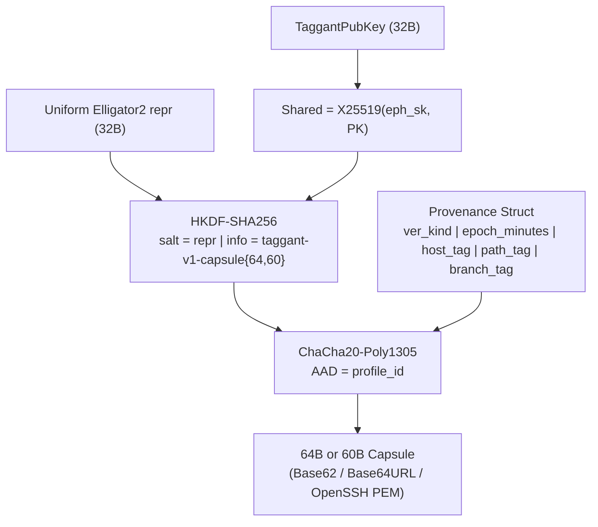

# Taggant Architecture (`taggant` v0.1.0)

> Or: how to lace your repository with radioactive dye that only glows under your own microscope.

---

## 1. The Threat Model, Stated Without Comforting Lies

Every classic honeytoken design hands the attacker one of two free gifts:

1. **The SaaS callback tells them they've tripped a wire.** If a decoy token hits an external domain over HTTPS or triggers a canary DNS lookup, any attacker auditing outbound traffic—or operating inside an air-gapped sandbox—spots the beacon immediately. Worse, if the sandbox blocks egress, your tripwire is a silent ornament.
2. **The symmetric local secret tells them which keys are fake.** If your workstation plants decoy tokens computed from a local HMAC secret or seeded PRNG, the exact moment a malicious `postinstall` script, compromised coding agent, or rogue MCP server achieves local user read access, it reads the minting secret too. Now the adversary tests every credential in `.env` against your HMAC, throws the decoys into the bin, and only steals the production Stripe key.

**Taggant** splits those two privileges across an asymmetric trapdoor: **your dev workstation holds only `TaggantPubKey` (minting privilege)**, while **your custody vault holds `TaggantAutopsyKey` (verification and decryption privilege)**. Knowing `TaggantPubKey` lets you plant ten thousand convincing decoys without conferring one bit of advantage toward identifying which keys are decoys.

---

## 2. Constant-Time $\mathbb{F}_{2^{255}-19}$ & Two-Branch `Elligator2` (`src/crypto/`)

Most developers who implement `Elligator2` from a blog post make the same fatal mistake: they invert only **one** branch of the quadratic residue test. On Curve25519 ($v^2 = u^3 + 486662 u^2 + u$, non-square $Z = 2$):

- Every representable curve $u$-coordinate ($u \notin \{0, -A\}$ where $w = -2u(u+A)$ is a square) admits **two distinct canonical preimages** in $[0, (p-1)/2]$:
  $$r_1 = \frac{\sqrt{w}}{2u}, \qquad r_2 = \frac{\sqrt{w}}{2(u + A)}$$
- Under the forward map ($d = -A / (1 + 2r^2)$, $g(d) = d^3 + Ad^2 + d$), feeding $r_1$ produces Legendre symbol $\varepsilon(g(d)) = +1$, while feeding $r_2$ produces $\varepsilon(g(d)) = -1$.
- If you only emit $r_1$, any cryptographer running a single Legendre check on your `sk-proj-` tokens watches $\varepsilon = +1$ hit 100% of the time instead of 50/50—and knows immediately your `.env` is full of fake tokens.

`src/crypto/fe25519.rs` implements constant-time 5x51-bit radix arithmetic modulo $p = 2^{255}-19$ using `u128` schoolbook multiplication and Fermat inversion (`p - 2`), while `src/crypto/elligator.rs` flips an unbiased CSPRNG bit between $r_1$ and $r_2$, normalizes the chosen preimage into $[0, (p-1)/2]$, and fills bits `254..255` with uniform CSPRNG entropy. The `512`-sample statistical uniformity test enforces both $\varepsilon = \pm 1$ branch balance inside `[38%, 62%]` and balanced top-2-bit buckets.

---

## 3. Capsule Wire Layouts (`src/crypto/capsule.rs`)

- **`64B` Capsule (`openai-proj`, `anthropic-api`, `openssh-key`):**
  `repr[32] || ciphertext[16] || poly1305_tag[16]` sealing `ver_kind: u8`, `epoch_minutes: u32`, `host_tag: [u8; 3]`, `path_tag: [u8; 4]`, `branch_tag: [u8; 4]`. Fits inside 86 Base62 characters ($62^{86} > 2^{512}$) or 86 unpadded Base64URL characters.
- **`60B` Compact Capsule (`github-pat`):**
  `repr[32] || ciphertext[12] || poly1305_tag[16]` sealing `ver_kind: u8`, `epoch_minutes: u32`, `host_tag: [u8; 2]`, `path_tag: [u8; 3]`, `branch_tag: [u8; 2]`. Fits cleanly inside `github_pat_<22>_<59>` (`81` Base62 characters).
- **Zero-Telltale OpenSSH Framing:** `openssh-key` builds a valid `openssh-key-v1\0` envelope carrying `capsule[32..64]` as the public key and `capsule[0..64]` as the private slot with generic comment `ssh-ed25519-deploy-key`—no branded strings anywhere in the PEM.

---

## 4. Custody Vault & Merkle Alert Chain (`src/vault/mod.rs`)

A bundled SQLite WAL database (`rusqlite 0.42.0`) with four tables that assume the disk itself will be inspected by a hostile neighbor:

| Table | What Lives There |
| :--- | :--- |
| `vault_meta` | `Argon2id` salt (`16B`), constant-time verifier (`32B`), `TaggantPubKey`, and `XChaCha20-Poly1305`-wrapped `TaggantAutopsyKey`. |
| `canaries` | Keyed `BLAKE3` blind index (`token_index`) + `XChaCha20-Poly1305` encrypted `CanaryRecord` bound to per-record UUID AAD. |
| `context_tags` | Encrypted resolution dictionary mapping both `64B` (`3B`/`4B`/`4B`) and `60B` (`2B`/`3B`/`2B`) `BLAKE3` tags back to plaintext hosts, paths, and branches. |
| `tripwire_alerts` | Append-only `BLAKE3` Merkle hash-chain (`entry_hash = BLAKE3(prev_hash \|\| "|" \|\| canonical_json)`) whose sensitive fields (`source_ip`, `method`, `request_path`, `token_preview`, `host_label`, `target_path_label`, `branch_label`) live exclusively inside `XChaCha20-Poly1305` `ciphertext`. |

Every mutation uses `BEGIN IMMEDIATE` with `PRAGMA secure_delete = ON`, and `enforce_vault_and_sidecar_acls` locks the directory, `taggant.db`, `-wal`, and `-shm` to the owning OS user (`icacls /inheritance:r` on Windows, `0700`/`0600` on Unix)—failing closed if ACL hardening fails.

---

## 5. Stealth Loopback Trap & Fleet Gate (`src/ops/`)

- **`taggant seed` (`src/ops/seed.rs`):** Writes `.env.staging` (or a named file) with 5 decoy credential families plus optional `INTERNAL_TELEMETRY_PING_URL=http://127.0.0.1:<port>/v1/ping/<canary>`. Because the env var avoids any `TAGGANT_` prefix, naive keyword searches over stolen repos don't advertise the trap.
- **`taggant verify-fleet` (`src/ops/scan.rs`):** Walks repositories while skipping `.git`, `target`, `node_modules`, `.venv`, and binary blobs, classifying every credential-shaped match as either `[TAGGANT:CANARY:VERIFIED]` or `[UNREGISTERED_SECRET]` so `/loom` sweeps never cry wolf on deliberate decoys.
- **`taggant watch` (`src/ops/watch.rs`):** Refuses non-loopback addresses (`!bind_addr.ip().is_loopback()`), enforces `16 KiB` / `5s` bounded reads, runs `run_autopsy` over incoming requests, appends a chained alert into `tripwire_alerts`, and replies with a realistic `401 Unauthorized` JSON error.

---

## 6. Known Limits (Because Pretending Otherwise Is How Breaches Happen)

- **Tier-2 formats (`ghp_`, `AKIA`) are too short for asymmetric curve points.** A 40-character `ghp_` token or 20-character `AKIA` ID physically cannot carry a 256-bit X25519 representative plus a 128-bit Poly1305 tag without bloating past regex matchers. Those two formats rely on `taggant.db` keyed `BLAKE3` lookup rather than offline zero-DB decoding.
- **Subgroup order check on `u`:** `x25519-dalek` clamped scalars sample from the prime-order subgroup $\mathcal{G}$, so an algebraic adversary inspecting `[\ell] \iota(\text{repr}) == \mathcal{O}` can probe subgroup membership—that matters only if your attacker already runs elliptic-curve group-order checks over every 86-character API token before exfiltrating `.env`, in which case you have an adversarial cryptanalyst living inside your `node_modules`.
- **Loopback watch only catches local probes.** `taggant watch` deliberately binds strictly to `127.0.0.1` / `::1` so it never exposes an inbound internet socket on your laptop. External exfiltration is caught asynchronously when leaked tokens hit `taggant autopsy`.
