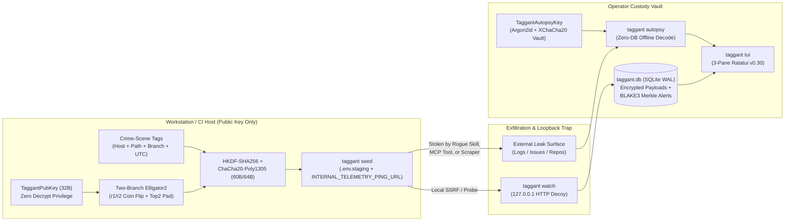

# Taggant (`taggant` v0.1.0)

[](https://github.com/tsiscoe/Taggant/actions/workflows/ci.yml)
[](LICENSE)
[](Cargo.toml)
[![Safety: #![forbid(unsafe_code)]](https://img.shields.io/badge/unsafe-forbid-success.svg)](src/lib.rs)

**Taggant** (`taggant`) is a pure-Rust (`#![forbid(unsafe_code)]`) **Asymmetric `Elligator2` Cryptographic Honeytoken Seeder, Stateless Offline Autopsy Engine, Fleet Sterility Gate, and Stealth Loopback Tripwire**.

---

## Why Does Taggant Exist?

Most honeytokens have the structural subtlety of a bear trap painted fluorescent orange with a sign next to it reading *"PLEASE STEP HERE."* Traditional decoy credentials fail at the exact two moments you actually need them:

1. **Cloud Webhook Canaries Broadcast Their Own Punchline.** SaaS canary tokens phone home to a third-party DNS or HTTP endpoint. Inside an air-gapped enclave they never fire at all; inside a hostile build environment, any intruder bright enough to inspect egress rules immediately notices an unfamiliar domain wired into your staging `.env` and walks right past it.
2. **Symmetric Local Decoys Collapse Under Host Compromise.** If your workstation mints decoy API keys with a local symmetric HMAC key, the first malicious `npm` postinstall script, poisoned MCP server, or rogue coding agent that reads your home directory doesn't just steal your real keys—it steals your HMAC key too, filters out every decoy in five milliseconds, and leaves you holding a forensic blindfold.

Named after the microscopic coded polymer chips mixed into commercial explosives—particles engineered to survive detonation so a forensic lab can pull one speck out of a crater and read the exact factory, batch, and date—**Taggant** takes the ability to verify a decoy away from the machine that plants it:

1. **Asymmetric Seeding (`TaggantPubKey` Only on Untrusted Hosts):** Workstations and CI runners carry only a 32-byte Curve25519 public key (`taggant-pub-v1:...`). They can mint unlimited OpenAI, Anthropic, GitHub, AWS, and OpenSSH decoys (`taggant seed`), yet possess **zero mathematical capability** to tell a decoy apart from a genuine CSPRNG credential or decrypt what is inside.
2. **Two-Branch Uniform `Elligator2` Capsules (`60B` / `64B`):** Every Tier-1 token embeds a 32-byte `Elligator2` ephemeral curve representative using randomized square-root preimage selection (`r1` vs `r2`) and top-2-bit uniformity padding, followed by `HKDF-SHA256` and `ChaCha20-Poly1305` sealing `12B`–`16B` of origin provenance (`epoch_minutes`, `host_tag`, `path_tag`, `branch_tag`) directly inside the key string itself. No entropy anomaly. No `taggant-` giveaway tag.
3. **Zero-DB Offline Autopsy (`taggant autopsy`):** Find a suspect token six months later in a public GitHub issue, an incident dump, or a third-party prompt log. Paste it into `taggant autopsy` on an offline workstation holding `TaggantAutopsyKey`, and—even with no database on disk—the capsule authenticates and spits out the exact mint minute and `BLAKE3` crime-scene fingerprints.
4. **Stealth Loopback Trap (`taggant watch`) & Fleet Gate (`taggant verify-fleet`):** `taggant seed --with-tripwire-port 19470` plants `INTERNAL_TELEMETRY_PING_URL=http://127.0.0.1:19470/v1/ping/<canary>` (zero `taggant` brand strings inside `.env.staging` for `grep` to choke on), while `taggant watch` logs local probes into an encrypted `BLAKE3` Merkle chain inside `taggant.db` and `taggant verify-fleet` distinguishes intentional decoys (`[TAGGANT:CANARY:VERIFIED]`) from genuine leaks (`[UNREGISTERED_SECRET]`).



---

## Cryptographic & Defense-in-Depth Spec Sheet

| Layer | Primitive | What It Actually Does |
| :--- | :--- | :--- |
| **Memory & Type Safety** | `#![forbid(unsafe_code)]` + `Zeroize` | Zero `unsafe` blocks anywhere in the crate; passphrases, `MasterSeed`, raw X25519 keys, and capsule keystreams wipe on drop. |
| **Field & Curve Map** | Constant-Time 5x51-bit $\mathbb{F}_{2^{255}-19}$ + Two-Branch `Elligator2` | Curve25519 ($A=486662, Z=2$) selecting 50/50 between both valid preimages ($r_1$, $r_2$) so the Legendre symbol never betrays the decoy. |
| **Capsule AEAD** | `X25519` + `HKDF-SHA256` + `ChaCha20-Poly1305` | Seals `16B` (`64B` capsule) or `12B` (`60B` capsule) provenance bound to `AAD = profile_id`; a single flipped character fails authentication. |
| **Vault Custody** | `Argon2id` (`64 MiB, t=3, p=4`) + `XChaCha20-Poly1305` + `rusqlite 0.42.0` | Encrypts `TaggantAutopsyKey`, planted canary metadata, context tag dictionaries, and `tripwire_alerts` payloads on disk (`PRAGMA secure_delete = ON`). |
| **Merkle Alert Ledger** | `BLAKE3` Chain + `BEGIN IMMEDIATE` + `icacls` / `0600` | Chains every loopback HTTP probe from `GENESIS` (`0000...0000`) and enforces owner-only ACLs fail-closed across DB and WAL sidecars. |
| **Terminal Sanitization** | `sanitize_terminal_str` (`CWE-150`) | Strips C0/C1 control bytes and ANSI/OSC escape sequences before rendering stolen HTTP paths or hostnames in `taggant tui`. |

---

## Bait Profiles

| Profile | Wire Shape | Capsule / Storage | Offline Zero-DB Autopsy |
| :--- | :--- | :--- | :--- |
| `openai-proj` | `sk-proj-` + `86` Base62 chars | **Tier-1 `64B` `Elligator2`** | Full `16B` provenance + `128-bit` Poly1305 MAC |
| `anthropic-api` | `sk-ant-api03-` + `86` Base64URL chars | **Tier-1 `64B` `Elligator2`** | Full `16B` provenance + `128-bit` Poly1305 MAC |
| `github-pat` | `github_pat_` + `22` Base62 + `_` + `59` Base62 | **Tier-1 `60B` `Elligator2`** | Compact `12B` provenance + `128-bit` Poly1305 MAC |
| `openssh-key` | Valid `openssh-key-v1` Ed25519 PEM block | **Tier-1 `64B` `Elligator2`** | Full `16B` provenance inside key slot |
| `github-classic` | `ghp_` + `30` Base62 + `6` Base62 IEEE `CRC32` | **Tier-2 Vault-Indexed** | Keyed `BLAKE3` blind-index lookup in `taggant.db` |
| `aws-iam-pair` | `AKIA` + `16` Base32 ID & `40` Base64 secret | **Tier-2 Vault-Indexed** | Keyed `BLAKE3` blind-index lookup in `taggant.db` |

---

## Quick Start

### 1. Build from Source

```bash
git clone https://github.com/tsiscoe/Taggant.git
cd Taggant
cargo build --release
```

### 2. Initialize Your Custody Vault (`taggant init`)

```bash
# Create encrypted vault (store passphrase in OS keyring) and export the safe-to-share public key
taggant --keyring init --export-pub ./taggant.pub
```

### 3. Seed Decoys Using Only `TaggantPubKey` (`taggant seed` / `taggant mint`)

```bash
# Plant a realistic .env.staging plus stealth INTERNAL_TELEMETRY_PING_URL on any untrusted host
taggant seed --target /srv/checkout --pub-key ./taggant.pub --with-tripwire-port 19470

# Or mint a single OpenSSH Ed25519 private key canary
taggant mint --profile openssh-key --pub-key ./taggant.pub --path /srv/checkout/id_ed25519
```

### 4. Verify Repository Hygiene (`taggant verify-fleet`)

```bash
# Separate registered Taggant decoys ([TAGGANT:CANARY:VERIFIED]) from uncatalogued leaks ([UNREGISTERED_SECRET])
taggant --keyring verify-fleet --dir /srv/checkout
```

### 5. Offline Autopsy, Loopback Trap & 3-Pane TUI (`autopsy` / `watch` / `tui`)

```bash
# Recover mint timestamp and crime-scene BLAKE3 tags offline from a leaked log or raw token
taggant --keyring autopsy ./incident-dump.log

# Zero-DB air-gapped recovery using exported TaggantAutopsyKey
taggant autopsy ./incident-dump.log --secret-key "$TAGGANT_AUTOPSY_KEY"

# Listen strictly on 127.0.0.1 for local scrapers or SSRF hitting INTERNAL_TELEMETRY_PING_URL
taggant --keyring watch --bind 127.0.0.1:19470

# Inspect planted canaries, offline autopsies, and the BLAKE3 Merkle alert chain
taggant --keyring tui
```

---

## Verification & Adversarial Test Suite

```bash
cargo fmt --all -- --check
cargo clippy --all-targets -- -D warnings
cargo test
```

---

## License

Licensed under the [MIT License](LICENSE). Because the only thing worse than getting breached is reading the leak on a paste site six months later and having to guess which contractor's laptop it walked off on.
